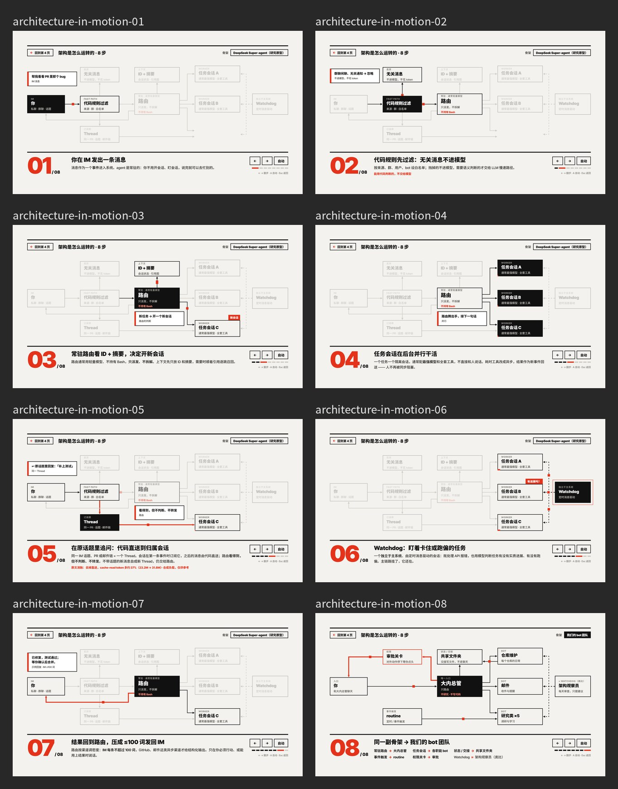

# Agent 架构分享：DeepSeek Super-agent、Personal Agent 与我们的实践

一套 HTML 演示稿（瑞士风格新版）。先讲 DeepSeek Super-agent 的架构（Router、任务会话、Thread 订阅与直送），再讲 personal agent，最后讲我们自己做的东西（Hive、bot 团队）和一些思考。主幻灯片里点进去可以看动画和架构详情页。

**在线观看：** https://tt-a1i.github.io/agent-arch-share/




## 键盘操作
- `←` / `→`、空格：翻页 / 下一步
- `f`：全屏
- `N`：显示 / 隐藏演讲者备注
- `Esc`：从详情页返回主幻灯片
- 架构动画页（detail/architecture-in-motion.html）按 `A`：自动播放

## 本地运行
直接用浏览器打开 `index.html`，或者：
```bash
python3 -m http.server 8000
# 打开 http://localhost:8000/
```
