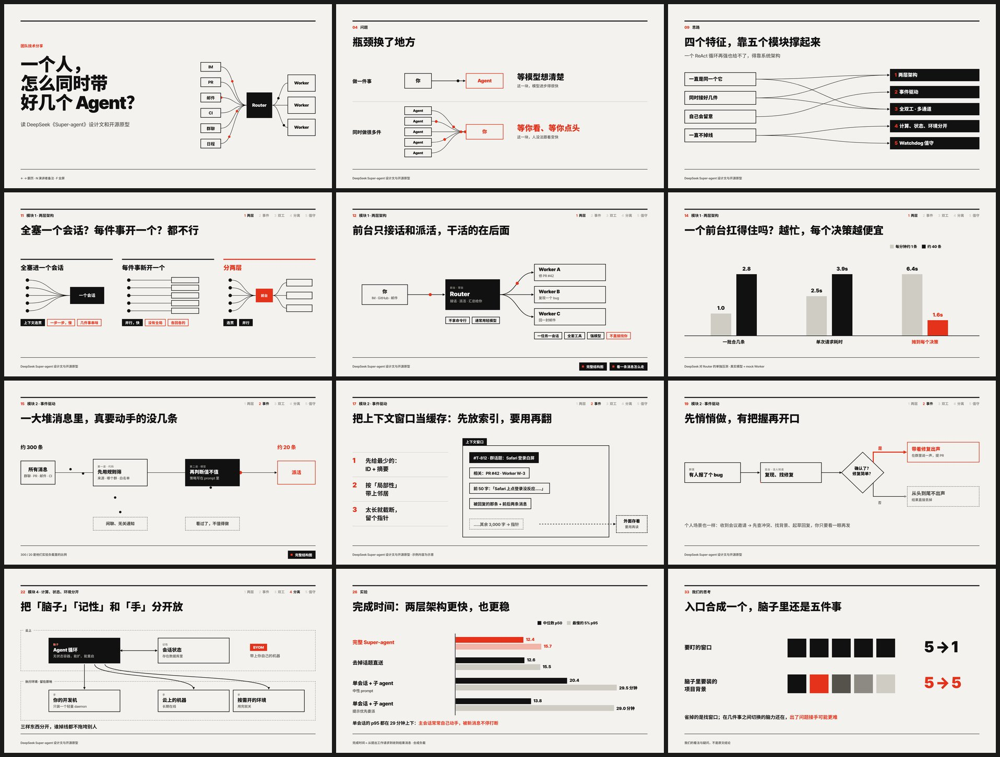

# 一个人，怎么同时带好几个 Agent？

面向团队的技术分享：读 DeepSeek《Super-agent》设计文和开源原型的笔记，共 41 页，分五段：

1. **问题**：瓶颈从模型换到了人的注意力
2. **思路**：四个特征，以及撑起它们的五个模块
3. **五个模块**：两层架构（含批处理）、事件驱动（两道过滤、按话题直送、Inline & Spill、Chain of Recall、投机执行）、全双工与多通道、计算/状态/环境分离、Watchdog
4. **实验与原型**：消融实验的完成时间和 token，开源原型的做法和边界
5. **我们的思考**：几个疑问、可以先试的做法、原文留下的开放问题

讲解细节都在演讲者备注里（按 `N`）。

**在线观看：** https://tt-a1i.github.io/agent-arch-share/



## 键盘操作
- `←` / `→`、空格：下一步 / 上一页（部分页面分步出现，按 `→` 逐步展开）
- `f`：全屏
- `N`：显示 / 隐藏演讲者备注
- `Esc`：从详情页返回主幻灯片
- 架构动画页（detail/architecture-in-motion.html）按 `A`：自动播放

## 本地运行
直接用浏览器打开 `index.html`，或者：
```bash
python3 -m http.server 8000
# 打开 http://localhost:8000/
```

## 回退
本仓库 Pages 源为 `main` 根目录。若需回到上一版，可用：
```bash
git revert HEAD
# 或：git reset --hard <上一 commit> && git push
```
